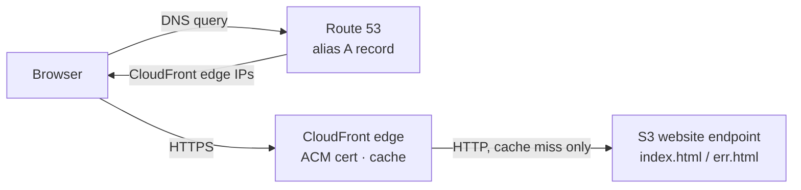
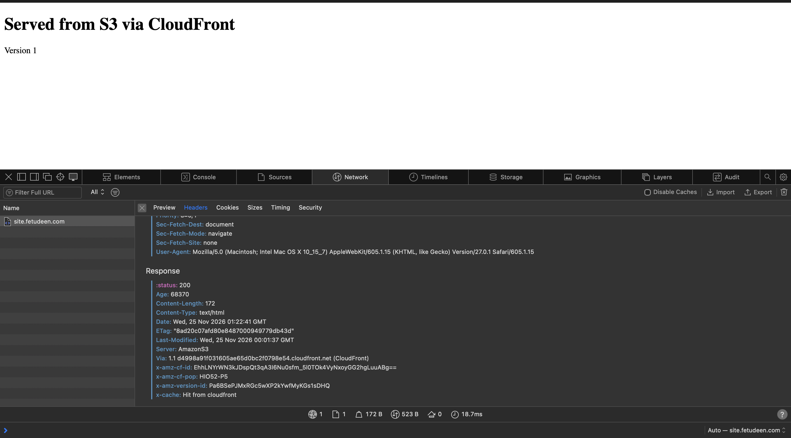
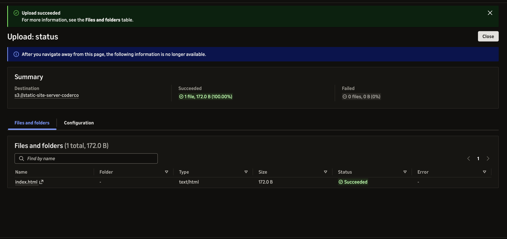
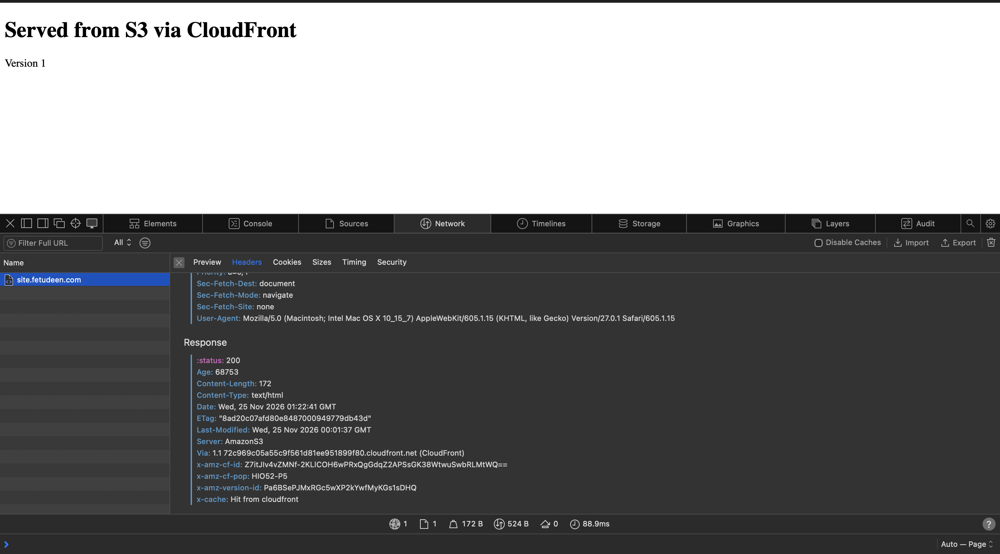
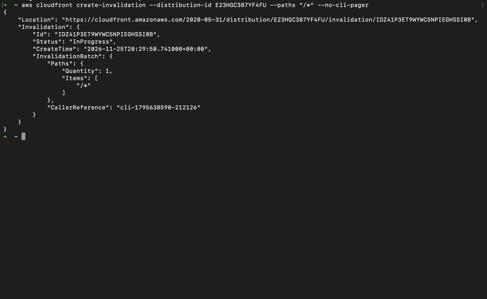
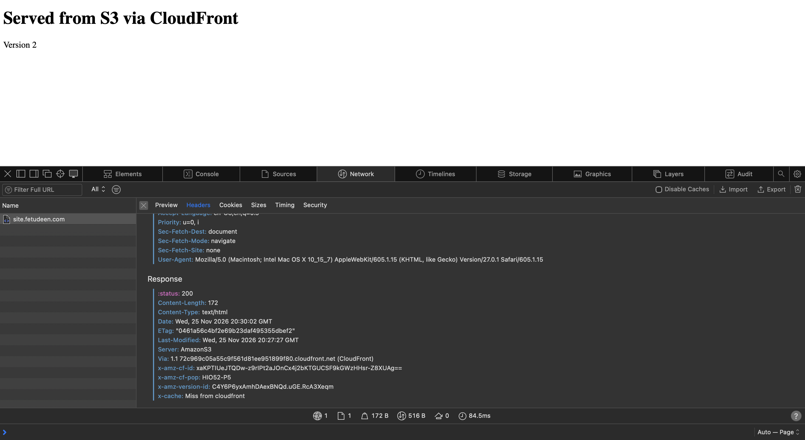
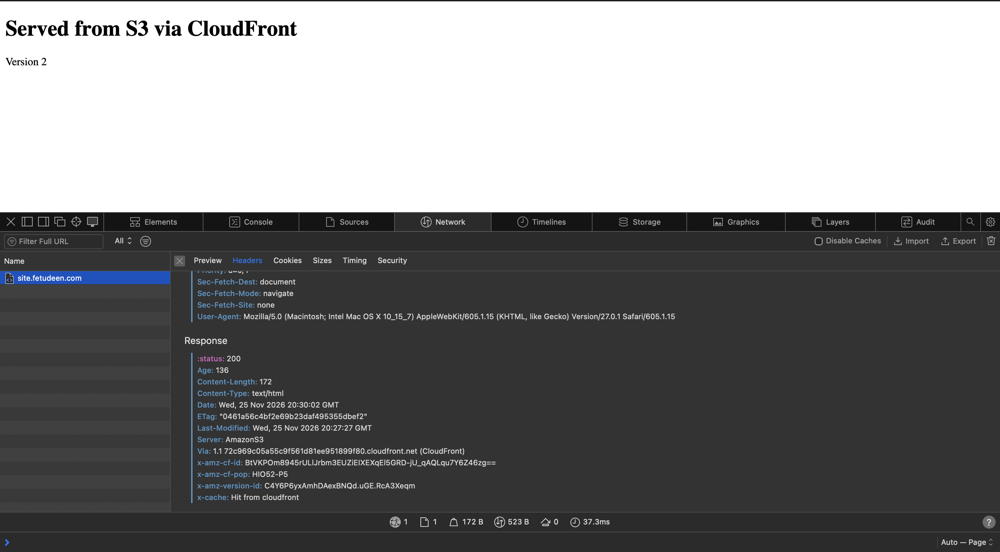

# Project 3: S3 Static Website + CloudFront CDN + Route 53

A production-style static website on AWS: **S3** for hosting, **CloudFront** for global caching and HTTPS, **ACM** for the TLS certificate, and **Route 53** for the custom domain.

**Live:** [https://site.fetudeen.com](https://site.fetudeen.com)

---

## Architecture



**Request flow**

1. The browser resolves `site.fetudeen.com`. Route 53 answers with CloudFront edge IPs through an alias record.
2. The browser connects over HTTPS. The edge presents the ACM certificate and redirects any plain HTTP to HTTPS.
3. **Cache hit:** the edge serves the file directly (`x-cache: Hit from cloudfront`).
4. **Cache miss:** the edge fetches from the S3 website endpoint over HTTP, caches the file for the TTL, compresses it, and returns it.

---

## Stack

| Layer | Service | Role |
|---|---|---|
| Storage / origin | Amazon S3 (static website hosting) | Stores and serves `index.html` and `err.html` |
| CDN | Amazon CloudFront | Edge caching, HTTPS, compression |
| TLS | AWS Certificate Manager (us-east-1) | DNS-validated public certificate |
| DNS | Amazon Route 53 | Hosted zone for `fetudeen.com`, alias record for `site` |

---

## What was built

### 1. S3 static website bucket

- Bucket: `static-site-server-coderco` (us-west-2)
- Static website hosting enabled. Index document `index.html`, error document `err.html`
- Versioning enabled, so every upload gets its own `x-amz-version-id` and older versions can be restored
- Block Public Access turned off at the bucket level so a public-read policy could be attached
- Bucket policy allows public `s3:GetObject` only. No listing, writing, or deleting.

```json
{
  "Version": "2012-10-17",
  "Statement": [
    {
      "Sid": "PublicReadGetObject",
      "Effect": "Allow",
      "Principal": "*",
      "Action": "s3:GetObject",
      "Resource": "arn:aws:s3:::static-site-server-coderco/*"
    }
  ]
}
```

### 2. ACM certificate

- Requested in **us-east-1**. CloudFront only reads certificates from that region, whatever region the bucket is in.
- DNS validation, with the validation CNAME created in Route 53 from the ACM console
- The validation record is kept permanently so ACM can auto-renew the certificate.

### 3. CloudFront distribution

| Setting | Value |
|---|---|
| Origin | S3 **website** endpoint (`<bucket>.s3-website-<region>.amazonaws.com`) |
| Origin protocol | HTTP only (S3 website endpoints don't support HTTPS) |
| Viewer protocol policy | Redirect HTTP to HTTPS |
| Allowed methods | GET, HEAD |
| Compression | Compress objects automatically |
| Cache policy | `Managed-CachingOptimized` |
| Alternate domain name | `site.fetudeen.com` |
| SSL certificate | ACM certificate (us-east-1) |

### 4. Route 53

- Used the existing hosted zone for `fetudeen.com`. The domain is registered at Porkbun, with its nameservers pointed at Route 53.
- Created an **alias A record** for `site.fetudeen.com` pointing to the CloudFront distribution
- Used a subdomain so the project stays separate from any future use of the apex domain

---

## Testing and verification

**HTTP → HTTPS redirect**
```bash
curl -I http://<distribution>.cloudfront.net
# HTTP/1.1 301 Moved Permanently
# Location: https://<distribution>.cloudfront.net/
# X-Cache: Redirect from cloudfront
```

**Content served through CloudFront**
```bash
curl -I https://site.fetudeen.com
# HTTP/2 200
# x-cache: Miss from cloudfront   (first request)
# x-cache: Hit from cloudfront    (repeat request)
```

**DNS resolves to CloudFront**
```bash
dig @1.1.1.1 site.fetudeen.com +short
# 18.65.238.61
# 18.65.238.8
# ...

dig -x 18.65.238.61 +short
# server-18-65-238-61.<pop>.r.cloudfront.net.
```

---

## Cache invalidation: proof with real headers

Version 2 was uploaded to S3 while CloudFront still had Version 1 cached. The edge kept serving the old copy until the cache was invalidated.

| # | Action | Page shows | `x-cache` | `Age` |
|---|---|---|---|---|
| 1 | Load site | Version 1 | Hit | 68370 |
| 2 | Upload Version 2 to S3 | — | — | — |
| 3 | Reload | **Version 1 (stale)** | Hit | 68753 |
| 4 | `create-invalidation --paths "/*"` | — | — | — |
| 5 | Reload | **Version 2** | **Miss** | *(none)* |
| 6 | Reload | Version 2 | Hit | 136 |

<table>
  <tr>
    <td width="50%"><br><b>1. Hit:</b> Version 1 served from the edge cache</td>
    <td width="50%"><br><b>2. Origin updated:</b> Version 2 uploaded to S3</td>
  </tr>
  <tr>
    <td width="50%"><br><b>3. Stale:</b> edge still serves Version 1, same ETag, older Age</td>
    <td width="50%"><br><b>4. Invalidate:</b> <code>/*</code> marked expired at every edge location</td>
  </tr>
  <tr>
    <td width="50%"><br><b>5. Miss:</b> edge fetches Version 2 from S3 (no Age, new ETag)</td>
    <td width="50%"><br><b>6. Hit:</b> Version 2 now served from the cache</td>
  </tr>
</table>

Step-by-step breakdown of every header: **[docs/cache-invalidation-walkthrough.md](docs/cache-invalidation-walkthrough.md)**

---

## Deploying changes

```bash
export DIST_ID=<your-distribution-id>
./scripts/deploy.sh
```

The script syncs `site/` to the bucket (`aws s3 sync --delete`) and invalidates `/*`, so every deploy is visible immediately.

---

## Repository structure

```
.
├── README.md
├── site/                       # website files deployed to S3
│   ├── index.html
│   └── err.html
├── infra/
│   ├── bucket-policy.json      # public-read policy (s3:GetObject only)
│   └── route53-alias.json      # alias A record → CloudFront
├── scripts/
│   └── deploy.sh               # sync to S3 + invalidate CloudFront
└── docs/
    ├── cache-invalidation-walkthrough.md
    └── screenshots/
```

---

## Troubleshooting log

Two real issues came up during the build.

### Issue 1: CloudFront returned 403 with the error page on `/`

**Symptom:** `https://<distribution>.cloudfront.net/` returned `HTTP/2 403` with `server: AmazonS3`, and the body was the contents of `err.html`.

**Investigation:**
- `aws s3 ls --recursive` showed `index.html` at the top level of the bucket, so the file existed.
- The response was a real HTML file (it had an `etag` and `last-modified`), not an XML error. The bucket policy was working.
- The CloudFront default root object was empty.

**Root cause:** the CloudFront origin was the S3 **REST** endpoint (`<bucket>.s3.<region>.amazonaws.com`), not the **website** endpoint. The console's bucket dropdown fills in the REST endpoint by default. The REST endpoint doesn't apply website hosting, so a request for `/` became a bucket listing. The policy doesn't allow listing, so S3 returned 403.

**Fix:** changed the origin to the S3 website endpoint (`<bucket>.s3-website-<region>.amazonaws.com`), then invalidated the cache.

**Lesson:** CloudFront also caches error responses, so after fixing an origin issue, invalidate before re-testing.

### Issue 2: Domain resolved everywhere except on the home network

**Symptom:** `dig @1.1.1.1 site.fetudeen.com` returned CloudFront IPs, and the site loaded on mobile data. The local resolver (the home router) returned `SERVFAIL` for every name under `fetudeen.com`, while still resolving other domains.

**Investigation:**

| Check | Command | Result |
|---|---|---|
| Delegation at the `.com` servers | `dig @a.gtld-servers.net NS fetudeen.com +norecurse` | 4 `awsdns` nameservers |
| Hosted zone nameservers | `aws route53 get-hosted-zone ... --query DelegationSet.NameServers` | Same 4. Delegation correct |
| DNSSEC | `dig @a.gtld-servers.net DS fetudeen.com +norecurse +short` | No DS record. Not a DNSSEC mismatch |
| Public resolvers | `dig @1.1.1.1` and mobile network | Resolved correctly |

**Root cause:** the home router's DNS service had saved a failure for the domain. The DNS configuration itself was correct.

**Fix:** restart the router, or point the machine at public DNS (`networksetup -setdnsservers Wi-Fi 1.1.1.1 8.8.8.8`).

**Lesson:** when one resolver fails and others succeed, check delegation and DNSSEC against the authoritative servers before changing any records.

---

## Key takeaways

- **Website endpoint vs REST endpoint.** Only the website endpoint serves index and error documents. It's HTTP-only and needs a public bucket, which is why OAC can't be used with it.
- **ACM certificates for CloudFront must be in us-east-1.**
- **An alternate domain name requires a matching certificate.** Without it, CloudFront rejects requests for the custom domain with a 403.
- **Alias records are preferred for AWS targets.** They work at the zone apex, Route 53 doesn't charge for alias queries to CloudFront, and every CloudFront alias uses the fixed hosted zone ID `Z2FDTNDATAQYW2`.
- **Caching is the point.** Updates are invisible until the TTL expires or the cache is invalidated, and that includes cached errors.

---

## Future integration points

### CI/CD with GitHub Actions
Automate deployment on every push to `main`:

```
push to main → GitHub Actions → assume IAM role (OIDC) → aws s3 sync --delete → CloudFront invalidation
```

- Use **OIDC** instead of long-lived access keys. Each run gets short-lived credentials.
- Limit the IAM role to this bucket and this distribution (least privilege).

### Security headers with CloudFront Functions
Attach a CloudFront Function on the **viewer response** event to add:
- `Strict-Transport-Security`
- `Content-Security-Policy`
- `X-Content-Type-Options`
- `X-Frame-Options`
- `Referrer-Policy`

Alternative with no code: the managed `SecurityHeadersPolicy` response headers policy.

### URL rewriting with Lambda@Edge
Attach a function on the **origin request** event to serve clean addresses, for example `/about` → `about.html`, without changing the address bar.
- Must be created in us-east-1 and attached by numbered version
- Runs only on cache misses, which keeps invocation costs low
- Production note: simple rewrites are usually done with CloudFront Functions, which are cheaper and lower-latency. Lambda@Edge is for heavier logic.

### Other improvements
- **Infrastructure as Code:** define the bucket, certificate, distribution, and DNS records in Terraform.
- **Private origin:** switch to the S3 REST endpoint with Origin Access Control (OAC) and keep the bucket fully private.
- **Custom error response:** map S3's 403 for missing files to a proper `404` response at CloudFront.

---

## Author

**Fetudin Mohammed (Fatu)**
[LinkedIn](https://linkedin.com/in/fetudeen) · [GitHub](https://github.com/Fetu-Deen)
