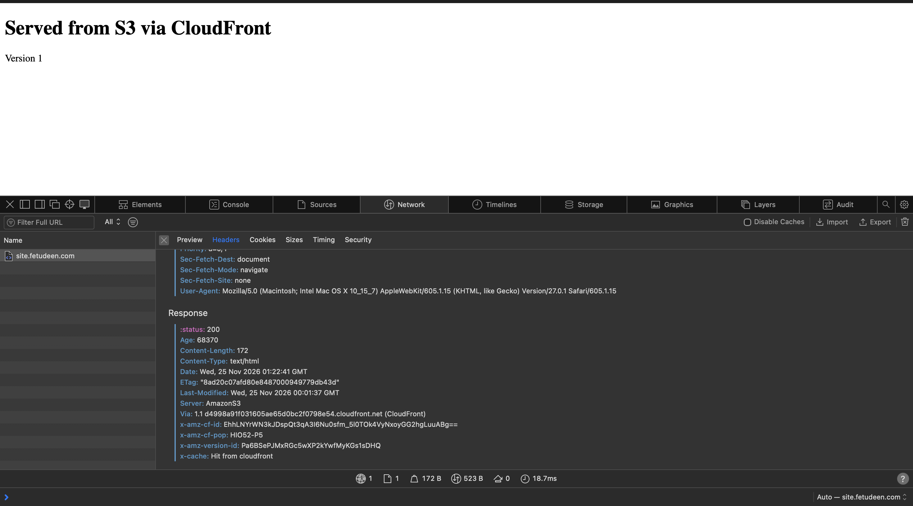
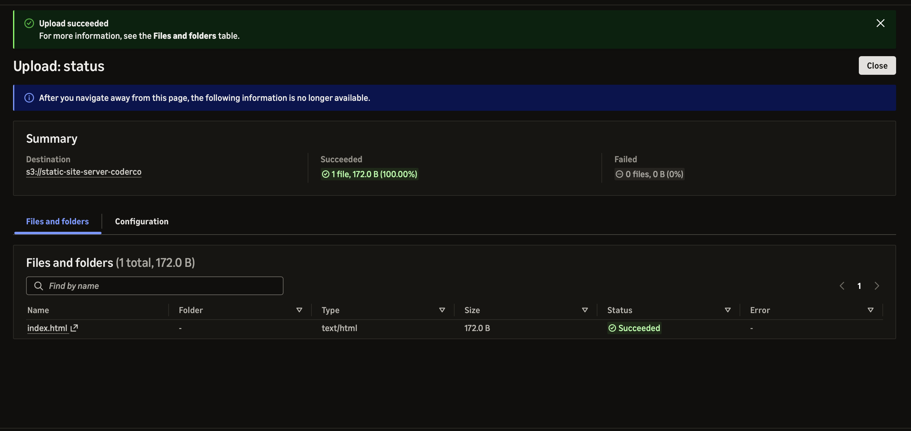
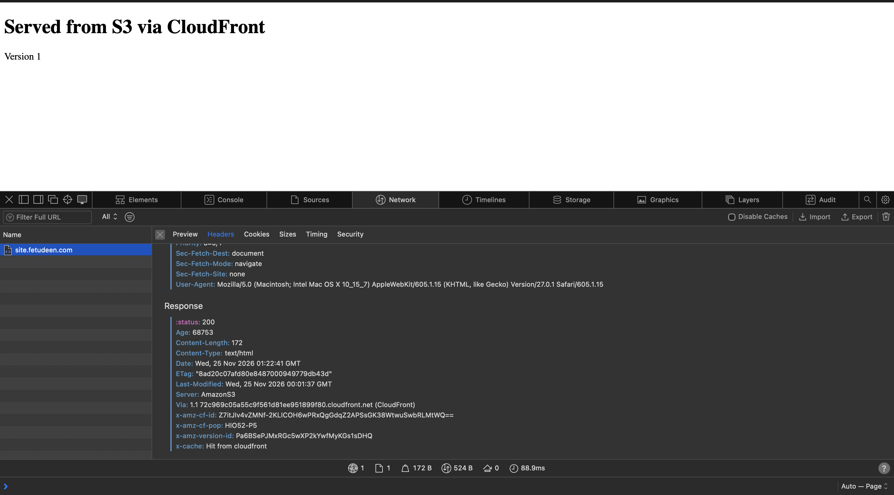
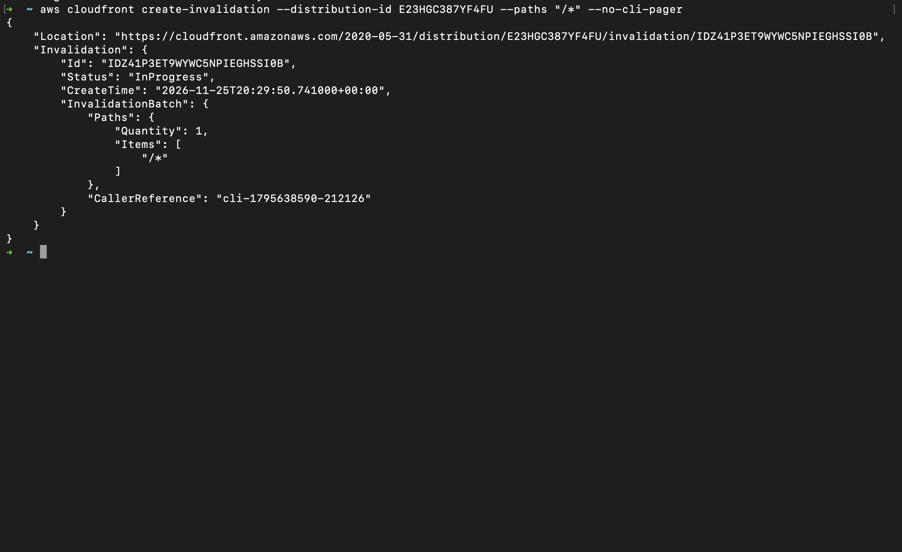
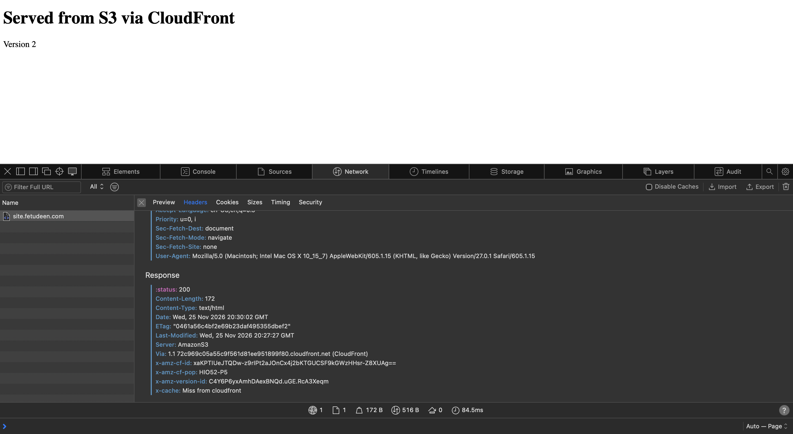
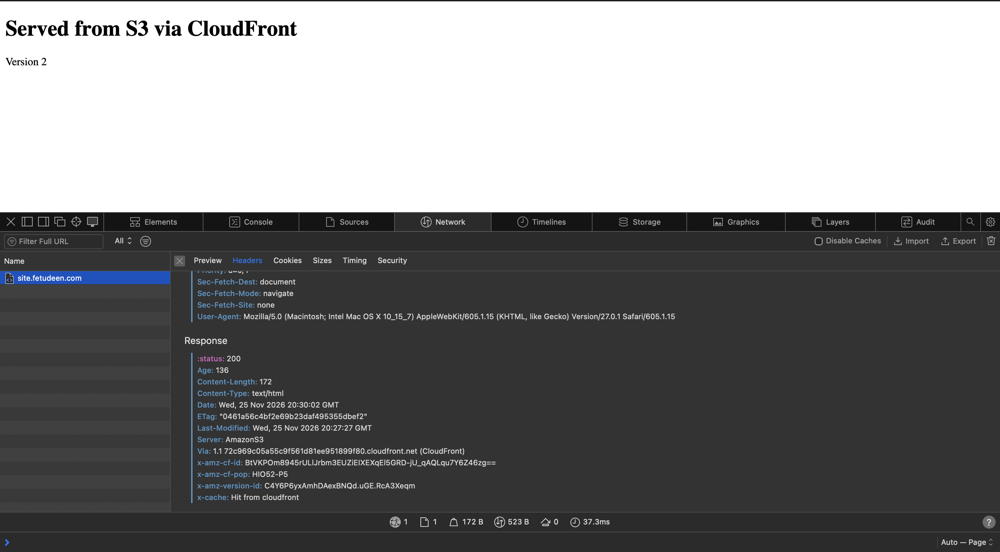

# Cache invalidation walkthrough

This walkthrough proves two things with real response headers:

1. **CloudFront caches content at the edge**, so changing the file in S3 alone doesn't change what visitors see.
2. **An invalidation forces the edge to fetch from S3 again**, after which the new version is cached in turn.

All requests were made to `https://site.fetudeen.com` with the browser's DevTools Network tab open, through the `HIO52-P5` edge location (Hillsboro, Oregon).

---

## The flow at a glance

| # | Action | Page shows | `x-cache` | `Age` | `ETag` |
|---|---|---|---|---|---|
| 1 | Load the site | Version 1 | Hit | 68370 | `8ad20c…` |
| 2 | Upload Version 2 to S3 | — | — | — | — |
| 3 | Reload the site | **Version 1** (stale) | Hit | 68753 | `8ad20c…` |
| 4 | Create invalidation `/*` | — | — | — | — |
| 5 | Reload the site | **Version 2** | **Miss** | *(none)* | `0461a5…` |
| 6 | Reload again | Version 2 | Hit | 136 | `0461a5…` |

**Headers to watch**
- `x-cache`: `Hit` means the edge answered from its cache. `Miss` means the edge fetched from S3.
- `Age`: seconds the response has been in the edge cache. It's missing on a fresh fetch.
- `ETag`: a fingerprint of the file's contents. A new ETag means a different file.
- `x-amz-version-id`: the S3 object version (bucket versioning is on). It changes with each upload.

---

## Step 1: Baseline, Version 1 served from cache



The page shows **Version 1**. `x-cache: Hit from cloudfront` and `Age: 68370` mean the edge has held this copy for about 19 hours. S3 isn't involved in this request at all.

---

## Step 2: Upload Version 2 to the origin



`index.html` was edited to say **Version 2** and uploaded to `s3://static-site-server-coderco` through the S3 console. The origin now has the new file. No invalidation has been run yet.

---

## Step 3: The edge still serves Version 1



This step proves the edge cache is separate from S3. Even though S3 now has Version 2:

- The page still shows **Version 1**
- `x-cache: Hit from cloudfront`
- `Age` has grown to `68753`: the same cached copy, just older
- `ETag` is still `8ad20c…`, the Version 1 file

CloudFront has no reason to ask S3 again until the 24-hour TTL (`CachingOptimized` default) runs out, or until the cache is invalidated.

---

## Step 4: Invalidate the cache



```bash
aws cloudfront create-invalidation --distribution-id <DIST_ID> --paths "/*" --no-cli-pager
```

- `--paths "/*"` marks every cached object in the distribution as expired.
- The response returns an invalidation `Id` and `"Status": "InProgress"`. It finishes at every edge location within seconds to a minute.
- `/*` counts as one path toward the 1,000 free invalidation paths per month.

---

## Step 5: Cache miss, Version 2 fetched from S3



On the first request after the invalidation:

- The page shows **Version 2**
- `x-cache: Miss from cloudfront`: the edge had nothing cached, so it went to S3
- **No `Age` header**: the response is brand new
- `ETag: 0461a5…` and a new `x-amz-version-id`: a different object from Step 1
- `Last-Modified: 20:27:27 GMT` matches the Step 2 upload time

The response `Date` (20:30:02 GMT) is about 12 seconds after the invalidation was created (20:29:50 GMT).

---

## Step 6: Version 2 is now the cached copy



On the next reload:

- `x-cache: Hit from cloudfront`: back to being served from the edge
- `Age: 136`: the Version 2 copy has been cached for just over 2 minutes
- Same `ETag` (`0461a5…`) and same `Date` as Step 5: this is the response saved during that miss

The edge will keep serving Version 2 from cache until the next invalidation or until the TTL expires.

---

## Takeaways

- **The origin and the edge are separate.** Uploading to S3 changes the origin only. Visitors see whatever the edge has cached.
- **Invalidation is how you publish changes immediately.** Without it, updates appear only when the TTL expires (24 hours here).
- **Headers are the evidence.** `x-cache`, `Age`, and `ETag` together show where a response came from and which version of the file it is.
- **In a deploy pipeline,** upload and invalidation always run together. See [`scripts/deploy.sh`](../scripts/deploy.sh).
